# TrafficMind AI

Trafik videosunda araç tespiti, çoklu nesne takibi ve sanal çizgi ile yönlü sayım.

Bu depo, eğitilmiş bir YOLO26n modelini Streamlit arayüzünde çalıştırır. Model her karede araç kutusu ve sınıf üretir. ByteTrack onaylı izlere numara verir. Kutunun alt orta noktası kullanıcının yerleştirdiği çizgiyi geçince geçiş, yöne göre bir kez yazılır. Aynı çalışma anlık yoğunluğu, sınıf dağılımını ve indirilebilir CSV dosyalarını da üretir.

Yazılı değerlendirme `Trafik_Arac_Tespiti_Raporu.docx` dosyasındadır. Bu sayfadaki sayılar o rapordaki doğrulanmış ölçümlerdir.

## Özellikler

- Altı sınıf: otobüs, otomobil, minibüs, motosiklet, kamyonet, kamyon. Taksi ayrı sınıf değildir.
- MP4, AVI ve MOV video yükleme.
- YOLO26n ile kare kare tespit. Çıkarım boyutu 640 pikseldir.
- ByteTrack ile takip numarası. Uygulama `src/video_analysis.py` içinde `bytetrack.yaml` çağırır.
- Yatay veya dikey sanal çizgi. Konum 0,05 ile 0,95 arasında ayarlanır. Varsayılan 0,62’dir.
- İki sayaç: o karede görünen araç sayısı ve çizgiyi geçen tekil araç sayısı.
- Aynı takip numarası aynı yönde varsayılan olarak bir kez sayılır. Bu anahtar kapatılabilir.
- Güven eşiği 0,10 ile 0,80 arasındadır. Varsayılan 0,25’tir.
- İşlenmiş video, kare istatistikleri ve geçiş CSV’si indirilebilir.
- Anlık yoğunluk, kümülatif geçiş ve sınıf dağılımı grafikleri arayüzde çizilir.

## Kullanılan teknolojiler

| Parça | Görev |
| --- | --- |
| Python 3.13 | Uygulama ve eğitim ortamı |
| PyTorch 2.11.0+cu128 | GPU üzerinde eğitim ve çıkarım |
| Ultralytics 8.4.214 | YOLO26n eğitimi, değerlendirme ve video akışı |
| OpenCV | Video okuma ve kutu çizimi |
| ByteTrack | Onaylı izleri kareler boyunca eşleme |
| Streamlit | Türkçe arayüz |
| Plotly ve pandas | Grafik ve CSV |
| imageio-ffmpeg | İşlenmiş videoyu tarayıcının açtığı H.264 MP4’e çevirme |

Bu bilgisayardaki ekran kartı NVIDIA GeForce RTX 5070 Ti’dir. CUDA tekeri `cu128` adresinden kurulmuştur. Başka bir ekran kartında aynı teker gerekmeyebilir. CUDA yoksa uygulama CPU’ya düşer.

## Sistem mimarisi

```text
Video → YOLO26n → ByteTrack → Sanal çizgi → Sayım → Streamlit
```

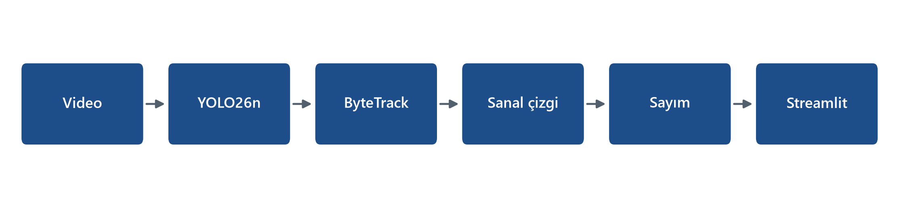

`app.py` videoyu kaydeder ve analizi başlatır. `src/video_analysis.py` modeli çalıştırır, kutuları çizer ve videoyu yazar. Sayım noktası kutunun alt orta noktasıdır. `src/counting.py` bu nokta çizgiyi geçince yönü belirler ve aynı yönü ikinci kez saymaz. `src/labels.py` sınıf adlarını Türkçeye çevirir.

## Veri seti

Eğitim görüntüleri Roboflow Universe üzerindeki vehicle-detection veri setinin 3. sürümüdür. Lisans CC BY 4.0’tır.

https://universe.roboflow.com/lynkeus03/vehicle-detection-by9xs/dataset/3

Roboflow görüntüleri otomatik yönlendirmiş ve 640×640 piksele esnetmiştir. Kendi açıklamasına göre dışa aktarımda veri artırma uygulanmamıştır. İşaretleme YOLOv8 biçimindedir. Toplam 9.211 görüntü ve 58.324 kutu vardır.

| Sınıf | Kutu | Pay |
| --- | ---: | ---: |
| Otomobil | 27.293 | %46,8 |
| Motosiklet | 14.971 | %25,7 |
| Otobüs | 6.681 | %11,5 |
| Kamyonet | 4.246 | %7,3 |
| Minibüs | 3.574 | %6,1 |
| Kamyon | 1.559 | %2,7 |

Görüntü başına ortalama 6,33 kutu vardır. Medyan 4, en yüksek değer 44’tür. Üç etiket dosyası boştur. Kutu genişliğinin medyanı 40,5 pikseldir.

Görüntüler rastgele bölünmemiştir. Aynı piksel kopyası, aynı algısal özet ve birbirine yakın ardışık kareler aynı grupta tutulmuştur. Gruplar 42 sabit tohumla yüzde 80 / 10 / 10 ayrılmıştır. Hiçbir grup iki bölüme birden girmemiştir.

| Bölüm | Görüntü | Kutu |
| --- | ---: | ---: |
| Eğitim | 7.369 | 49.858 |
| Doğrulama | 921 | 4.186 |
| Test | 921 | 4.280 |

En büyük benzer grup 2.432 görüntüdür ve tümü eğitimdedir. Bu yüzden otomobil kutularının yüzde 86,7’si eğitimde kalır. Altı sınıf da üç bölümde vardır. Ayrıntı `reports/dataset_audit.json` ve `reports/split_manifest.csv` dosyalarındadır.

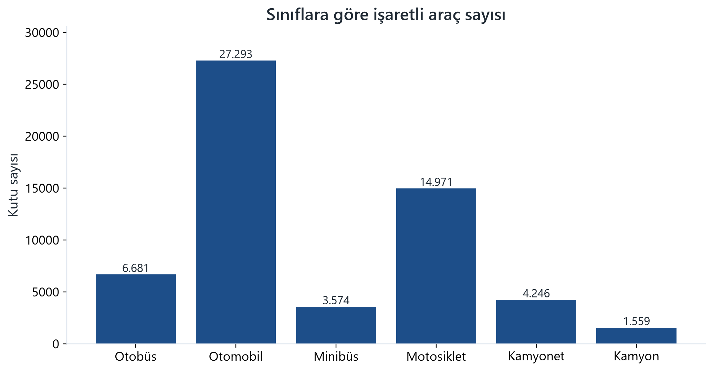

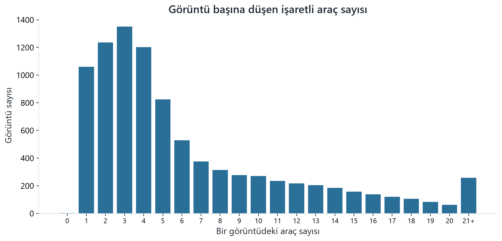

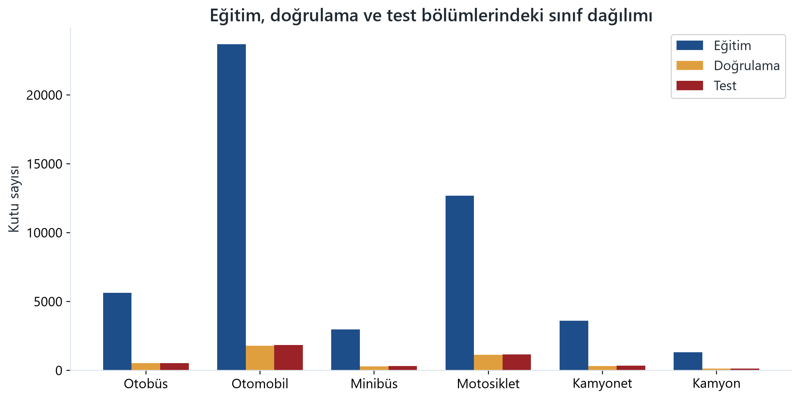

Görüntü dosyaları bu depoda yoktur. Yaklaşık 1,1 GB tutarlar ve Roboflow’dan indirilir. İndirilen `train/images` ile `train/labels` proje köküne konduktan sonra bölme yeniden üretilebilir:

```powershell
.\.venv\Scripts\python.exe scripts\prepare_dataset.py
```

Betik `train/` klasörünü değiştirmez. Bölünmüş kopyayı `dataset_split/` altına yazar. Eğitim dosyası `dataset_split/data.yaml` dosyasıdır. Bu dosya depodadır. Görüntü klasörleri `.gitignore` ile dışarıda bırakılmıştır.

## Model eğitimi

Başlangıç ağırlığı COCO üzerinde eğitilmiş `yolo26n.pt` dosyasıdır. Ultralytics’in yayımladığı kartta katlanmış YOLO26n için 2,4 milyon parametre, 5,5 GFLOP ve COCO doğrulama mAP50-95 değeri 40,9 yazar. Aynı belgenin notu, kayıtlı kontrol noktasının daha yüksek parametre sayısı gösterebileceğini belirtir. Bu projedeki `best.pt` yüklendiğinde 261 katman, 2.536.316 parametre ve 6,0 GFLOP okunmuştur. Aşağıdaki trafik skorları COCO skoru değildir.

Kullanılan eğitim komutu:

```powershell
.\.venv\Scripts\yolo.exe detect train model=yolo26n.pt data=dataset_split/data.yaml epochs=100 imgsz=640 batch=16 device=0 workers=4 project=runs name=yolo26n
```

Kayıtlı ayarlar: 100 epoch, görüntü boyutu 640, yığın boyutu 16, GPU 0, 4 işçi, karışık kesinlik açık, tohum 0, erken durdurma sabrı 100. Optimizer `auto`, başlangıç öğrenme oranı 0,01, son oran bunun 0,01 katı, momentum 0,937, ağırlık sönümü 0,0005, ısınma 3 epoch’tur. Kayıp kazançları kutu 7,5, sınıf 0,5 ve DFL 1,5’tir. Epoch günlüğü kutu, sınıf ve L1 kaybını yazar.

Tespit artırması renk değişimi, yüzde 10 öteleme, ölçek, yatay çevirme, mozaik ve rastgele silmedir. Son 10 epoch’ta mozaik kapatılmıştır. Dikey çevirme kapalıdır. `args.yaml` içindeki `auto_augment: randaugment` alanı sınıflandırma veri kümesine aittir. Tespit eğitimi onu kullanmaz. Bu dosya kişisel kayıt yolu içerdiği için depoya konmamıştır.

Ultralytics klasörü `runs/detect` altına açtığı için ağırlıklar şu yoldadır:

`runs/detect/runs/yolo26n/weights/best.pt`

`best.pt` 5,21 MB’dir. GitHub’ın tek dosya sınırı 100 MB olduğu için Git LFS gerekmemiştir. Dosya doğrudan depoyadır. Uygulama bu yolu okur. `last.pt` de 5,21 MB’dir ve depodadır, fakat uygulama onu kullanmaz.

En iyi epoch, doğrulama mAP50-95 değeri en yüksek satırdır. `results.csv` içinde bu satır 66. epoch’tur: mAP50 0,8217 ve mAP50-95 0,51845. Günlükteki precision 0,791, recall 0,769’dur. Eğitim bitince `best.pt` yeniden değerlendirildiğinde precision ve recall biraz farklı basılmıştır. Raporun başlık sayıları bu son değerlendirmedir. 100. epoch’un mAP50-95 değeri 0,49824’tür.

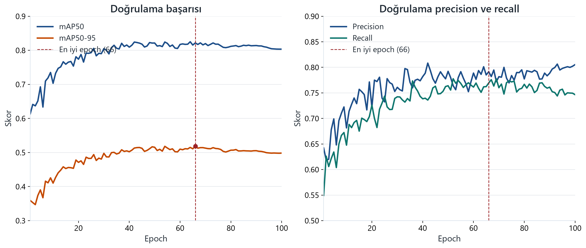

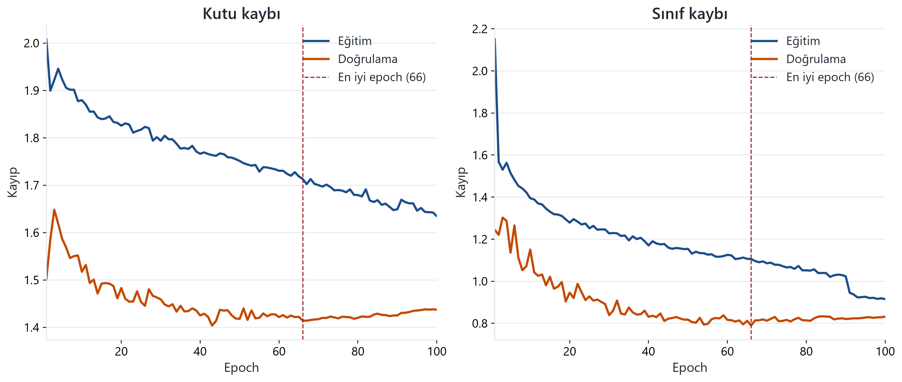

## Model performansı

`best.pt`, 921 doğrulama görüntüsü ve 921 test görüntüsü üzerinde ayrıca değerlendirilmiştir.

| Bölüm | Kutu | Precision | Recall | mAP50 | mAP50-95 |
| --- | ---: | ---: | ---: | ---: | ---: |
| Doğrulama | 4.186 | 0,769 | 0,822 | 0,822 | 0,518 |
| Test | 4.280 | 0,768 | 0,779 | 0,828 | 0,523 |

Test, doğrulamadan belirgin biçimde kötü değildir. mAP50 nesneyi yüzde 50 örtüşmede bulmayı ölçer. mAP50-95 eşiği sıkılaştırır. İkinci değer yaklaşık 0,52’dir. Aynı test çalıştırmasında görüntü başına süre yaklaşık 0,8 ms ön işleme, 1,1 ms çıkarım ve 1,2 ms son işlemedir.

Testteki sınıf sonucu:

| Sınıf | Kutu | Precision | Recall | mAP50 | mAP50-95 |
| --- | ---: | ---: | ---: | ---: | ---: |
| Otobüs | 536 | 0,754 | 0,858 | 0,881 | 0,622 |
| Otomobil | 1.832 | 0,915 | 0,812 | 0,919 | 0,590 |
| Minibüs | 302 | 0,589 | 0,818 | 0,774 | 0,511 |
| Motosiklet | 1.157 | 0,864 | 0,793 | 0,858 | 0,386 |
| Kamyonet | 330 | 0,744 | 0,733 | 0,783 | 0,517 |
| Kamyon | 123 | 0,739 | 0,659 | 0,751 | 0,513 |

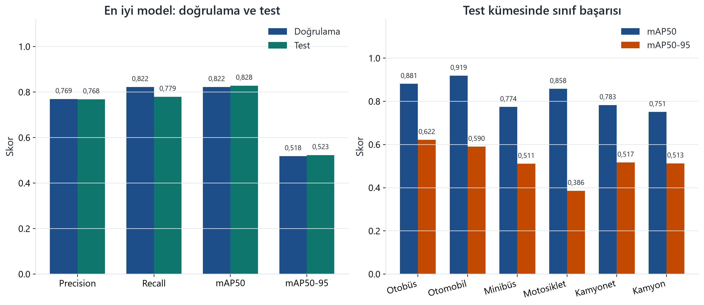

Doğrulama karışıklık matrisinde satır tahmindir, sütun gerçek etikettir. Köşegenler otobüste 0,97, otomobilde 0,92 ve motosiklette 0,97’dir. Minibüs köşegeni 0,82’dir. Minibüslerin 0,14’ü otomobil diye yazılmıştır. Kamyon köşegeni 0,73’tür. Kamyonların 0,19’u kamyonettir. Arka plan sütununda motosiklet 0,37’dir. Bu, eşleşen gerçek kutusu olmayan motosiklet tahminidir.

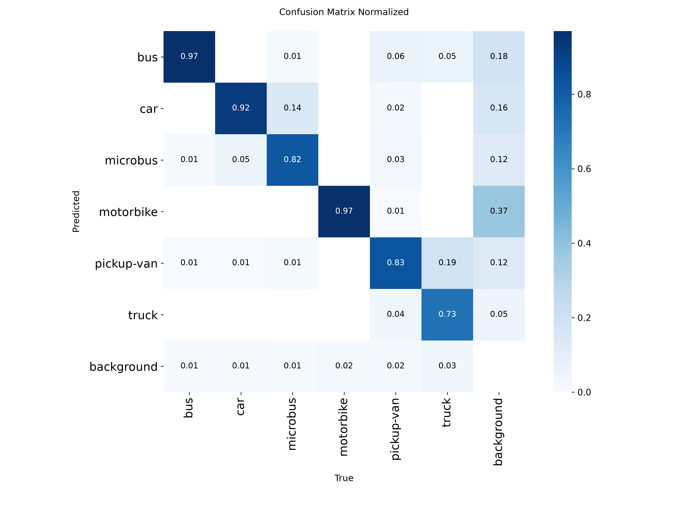

## Kurulum

Windows ve Python 3.13 ile kurulan sıra budur. PyTorch, Ultralytics’ten önce kurulur. Böylece sonraki `pip install` CUDA tekerini CPU tekeriyle değiştirmez.

```powershell
py -3.13 -m venv .venv
.\.venv\Scripts\python.exe -m pip install --upgrade pip
.\.venv\Scripts\python.exe -m pip install torch torchvision --index-url https://download.pytorch.org/whl/cu128
.\.venv\Scripts\python.exe -m pip install -r requirements.txt
```

`requirements.txt` şunları ister: NumPy, OpenCV, Pillow, PyYAML, Matplotlib, Ultralytics, lap, tqdm, Streamlit, Plotly, pandas ve imageio-ffmpeg. Torch bu listeye yazılmamıştır. CUDA tekeri yukarıdaki ayrı komutla gelir.

GPU kontrolü:

```powershell
.\.venv\Scripts\python.exe -c "import torch; print(torch.__version__, torch.cuda.is_available())"
```

Uygulama:

```powershell
.\.venv\Scripts\python.exe -m streamlit run app.py
```

`best.pt` depoda olduğu için uygulamayı çalıştırmak yeniden eğitim istemez. Yeniden eğitim, Roboflow görüntülerinin indirilmesini ve `scripts/prepare_dataset.py` çalıştırılmasını ister.

## Kullanım

1. Açılan sayfadan MP4, AVI veya MOV bir trafik videosu seçin.
2. Kenar çubuğundan güven eşiğini belirleyin. Eşik düşünce uzak araçlar daha çok görünür, yanlış kutu da artar.
3. Sayım çizgisini yatay veya dikey seçin ve konumu, araçların geçtiği yere getirin. Sarı çizgi önizlemede görünür.
4. “Aynı aracı aynı yönde bir kez say” anahtarı açıksa aynı iz aynı yönde ikinci kez eklenmez.
5. “Analizi başlat” düğmesine basın.
6. İşlenmiş videoyu, kare istatistiklerini ve geçiş kayıtlarını indirin.

Çıktı `outputs/analyses/` altına yazılır. Bu klasör depoya konmaz. Yan paneldeki epoch, mAP50 ve mAP50-95 değerleri `results.csv` günlüğünden okunur. Bunlar eğitim sırasındaki doğrulama satırıdır. Test tablosundaki 0,828 ve 0,523 ile karıştırılmamalıdır.

## Örnek çıktılar

Üç kısa kayıt Pexels trafik videosu aramasından alınmıştır:

https://www.pexels.com/tr-tr/arama/videos/trafik/

Kayıtlar `Test_video_sonuç/` klasöründedir. Ayrı bir insan sayımı yapılmamıştır. Aşağıdaki geçiş sayıları sistemin yazdığı kayıtlardır.

| Video | Çözünürlük | Süre | Sistemin yazdığı geçiş |
| --- | --- | --- | ---: |
| 1, `Test.mp4` | 2160×3840 | 20,8 sn | 38, kaydedilen grafik. Geçiş CSV’si yoktur. |
| 2, `Test2.mp4` | 2160×3840 | 16,1 sn | 26. Hepsi aşağı: 22 otomobil, 2 kamyonet, 2 motosiklet. |
| 3, işlenmiş çıktı | 3840×2160 | 20,8 sn | 32. 31 yukarı, 1 aşağı: 23 otomobil, 5 kamyonet, 3 motosiklet, 1 kamyon. |

Video 1’in 38 sayısı sınıf grafiğindeki 30 otomobil, 6 kamyonet ve 2 motosiklet çubuğundan okunmuştur. CSV olmadığı için satır satır doğrulanmamıştır.

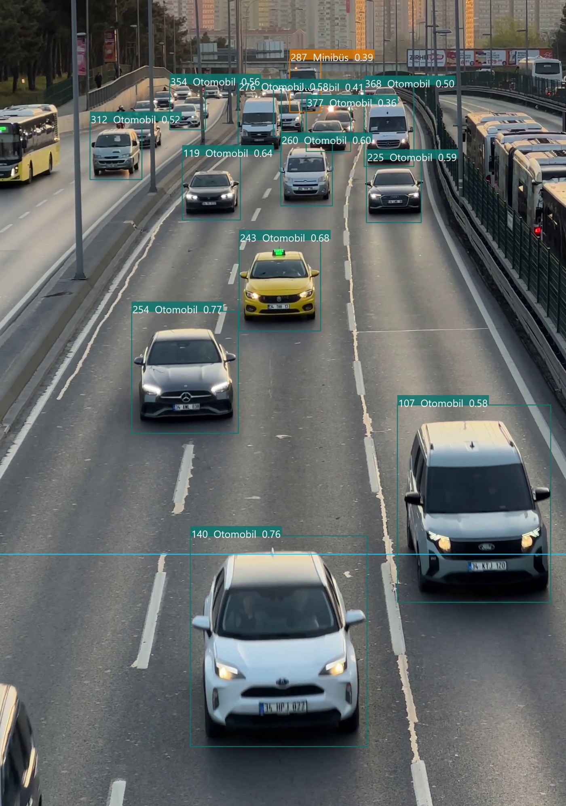

Soldaki otobüs bu karede otomobil diye işaretlenmiştir. Yakın otomobiller daha yüksek güvenle kutulanmıştır.

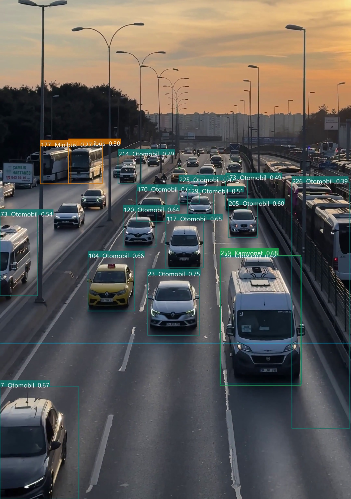

Sarı taksi otomobil, beyaz panelvan kamyonet olarak yazılmıştır. Otobüs gövdesinde minibüs ve otobüs etiketleri üst üste binmektedir.

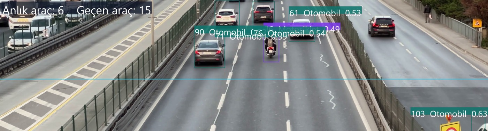

Bu karede sayaç anlık 6, geçen 15’tir. Yatay çizgi sayım çizgisidir. Motosiklet kutulanmıştır. Uzaktaki bazı araçlarda kutu yoktur.

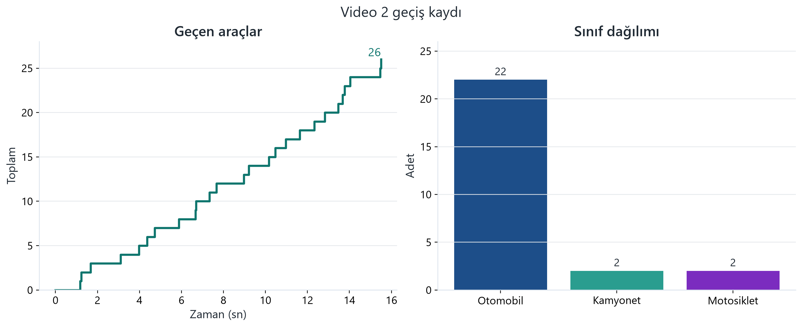

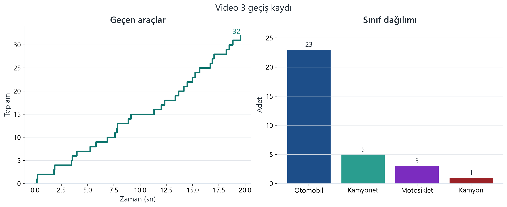

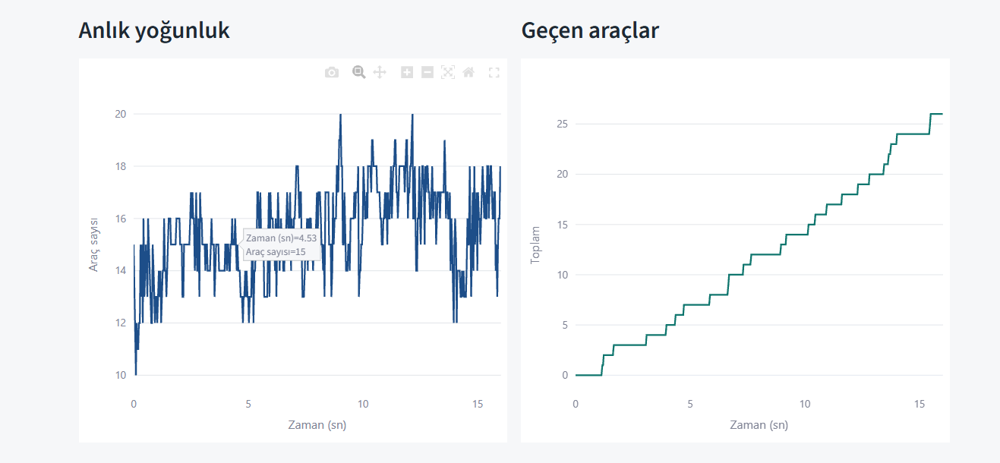

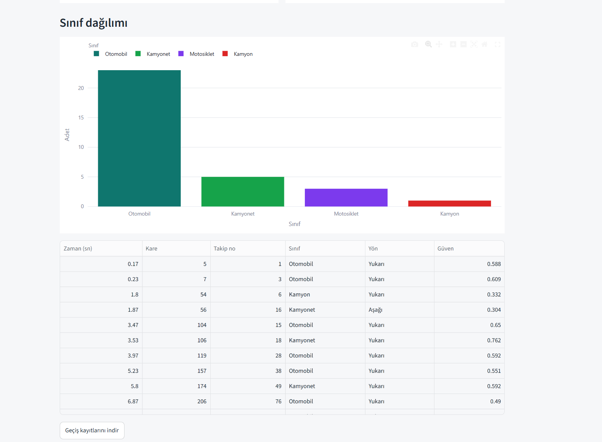

## Bilinen sınırlamalar

- Uzak ve küçük araçlar 640 piksel çıkarımda kaçabilir. Deneme videoları 4K’dır. Eğitim görüntüleri daha yakın kadrajlıdır.
- ByteTrack yalnızca onayladığı izi çizer. Bir araç bir karede görünüp sonraki karede kaybolabilir. Anlık sayı bu yüzden dalgalanır.
- Minibüs ile otomobil, kamyon ile kamyonet karışır. Motosikletin mAP50-95 değeri 0,386’dır. Kutu bulunur, kenarı gevşektir.
- Düşük güven eşiği gürültülü geçiş de yazar. Video 3’te 0,279’a inen kayıtlar ve 0,304 güvenli ters yönlü bir kamyonet vardır.
- Taksi etiketi yoktur. Sarı taksi otomobil veya başka bir gövde sınıfı olarak yazılır.
- Üç video için ikinci bir kişinin sayımı yoktur. Sistem sayısının yüzde doğruluğu hesaplanmamıştır.
- Algısal uzaklığı 12’den büyük olan aynı kamera kareleri eğitim ve test arasında ayrılmış olabilir.

## Kaynaklar ve lisans

Veri seti CC BY 4.0 lisansındadır:

https://universe.roboflow.com/lynkeus03/vehicle-detection-by9xs/dataset/3

Ultralytics YOLO26 belgesi ve tespit modeli kartı:

https://docs.ultralytics.com/models/yolo26

https://docs.ultralytics.com/tasks/detect

Ultralytics kodu AGPL-3.0 lisansındadır:

https://github.com/ultralytics/ultralytics

İzleme kipi ve bu uygulamada kullanılan ByteTrack ayarı:

https://docs.ultralytics.com/modes/track

Zhang, Yifu ve diğerleri. ByteTrack: Multi-Object Tracking by Associating Every Detection Box. arXiv:2110.06864.

https://arxiv.org/abs/2110.06864

https://github.com/FoundationVision/ByteTrack

Pexels trafik videosu araması:

https://www.pexels.com/tr-tr/arama/videos/trafik/

PyTorch, OpenCV ve Streamlit:

https://pytorch.org

https://opencv.org

https://streamlit.io

Bu deponun kendi kaynak dosyaları için ayrı bir lisans metni eklenmemiştir. Bağımlılıkların lisansları kendi depolarında geçerlidir.

## Klasör yapısı

```text
app.py                          Streamlit arayüzü
src/video_analysis.py           Tespit, ByteTrack ve video yazımı
src/counting.py                 Sanal çizgi
src/labels.py                   Türkçe sınıf adları
src/training_summary.py         results.csv içinden seçilen epoch
scripts/prepare_dataset.py      Gruplu veri bölme
dataset_split/data.yaml         Bölüm yolları
runs/detect/runs/yolo26n/       Eğitim günlüğü ve best.pt
reports/                        Bölme denetimi ve rapor grafikleri
docs/images/                    Bu sayfadaki görseller
Test_video_sonuç/               Üç deneme kaydı
Trafik_Arac_Tespiti_Raporu.docx Yazılı rapor
requirements.txt
```

Depoda olmayanlar: `.venv`, `outputs/`, orijinal `train/` görüntüleri, `dataset_split` görüntü kopyaları ve kişisel yol içeren `args.yaml`.
